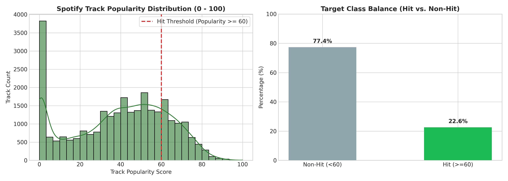
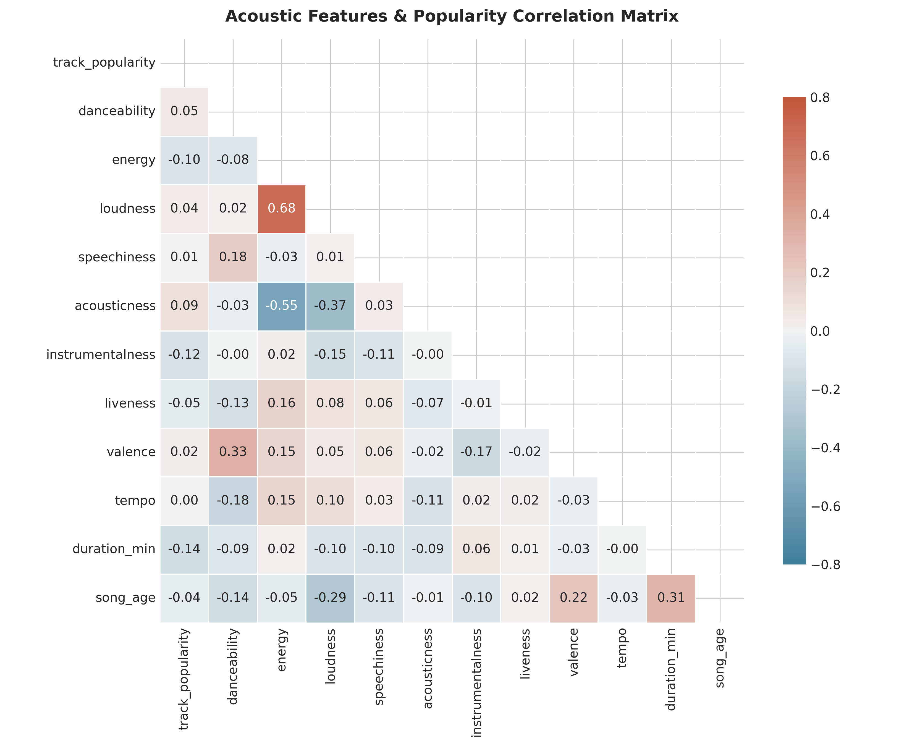

# Spotify Şarkılarında Hit Tahmini: Akustik Özelliklerle Makine Öğrenmesi ve Açıklanabilir Yapay Zekâ

**Hazırlayan:** Hazal  **Proje türü:** Makine öğrenmesi + derin öğrenme (ikili sınıflandırma)
**Kod (GitHub):** https://github.com/hazalakks/spotify-hit-predictor
**Notebook:** `notebooks/spotify_hit_prediction_pipeline.ipynb`

---

## 1. Problem Tanımı

Müzik platformlarında her gün on binlerce yeni şarkı yayınlanıyor. Plak şirketleri ve çalma listesi editörleri hangi şarkıya tanıtım bütçesi ayıracaklarına karar vermek zorunda. Bu projede bir şarkının **akustik özellikleri** (dans edilebilirlik, enerji, ses yüksekliği, tempo vb.), **türü** ve **yayın yılı** girdi olarak kullanılıyor. Hedef çıktı, şarkının Spotify popülerlik skorunun **60 veya üzerinde (Hit)** olup olmayacağı. Amaç, yayın öncesinde potansiyeli yüksek şarkıları önceliklendirmeye yardımcı bir karar destek modeli kurmak ve hit olmayı hangi ses özelliklerinin etkilediğini açıklamak.

## 2. Veri Seti

- **Kaynak:** Spotify Web API üzerinden derlenmiş *Spotify Songs* veri seti (TidyTuesday, 2020-01-21). Bağlantı: https://github.com/rfordatascience/tidytuesday/tree/master/data/2020/2020-01-21
- **Boyut:** 32.833 satır, 23 sütun. Aynı şarkı birden fazla çalma listesinde tekrarlandığı için `track_id` üzerinden tekilleştirme sonrası **28.352 tekil şarkı** kaldı.
- **Değişkenler:** `danceability`, `energy`, `loudness`, `speechiness`, `acousticness`, `instrumentalness`, `liveness`, `valence`, `tempo`, `duration_ms`, `key`, `mode`, `playlist_genre` (pop, rap, rock, latin, r&b, edm), `track_album_release_date`.
- **Hedef değişken:** `is_hit = 1` eğer `track_popularity ≥ 60`.
- **Sınıf dengesizliği:** 6.417 Hit (**%22,6**) ve 21.935 Non-Hit (**%77,4**). Oran yaklaşık 1 : 3,4.

## 3. Veri Keşfi (EDA)

**Gözlem 1: Hedef dağılımı.** Popülerlik medyanı 42. Şarkıların %9,2'si 0 puanda, bunlar büyük olasılıkla katalogda dinlenmeyen kayıtlar. 60 eşiği en popüler yaklaşık %23'lük dilimi ayırıyor. Dengesizlik nedeniyle accuracy tek başına yanıltıcı olacağından PR-AUC, F1 ve recall da raporlandı.

**Gözlem 2: Tür etkisi.** Hit oranı türe göre çok değişiyor: pop %35,3, rock %25,9, latin %24,5, rap %23,5, r&b %19,0, **edm yalnızca %7,2**. Tür güçlü bir öncül bilgi taşıdığı için modele one-hot olarak eklendi.

**Gözlem 3: Doğrusal ilişkiler zayıf.** Popülerlikle en güçlü korelasyonlar bile küçük: `instrumentalness` (−0,12), `energy` (−0,10), `acousticness` (+0,09). Buna karşılık özellikler kendi aralarında güçlü ilişkili: `energy`–`loudness` +0,68, `energy`–`acousticness` −0,55. Tek bir özellik hit olmayı açıklamıyor. Bu durum, etkileşimleri yakalayabilen doğrusal olmayan modellerin (ağaç toplulukları, sinir ağı) gerekli olduğunu gösteriyor.

**Gözlem 4: Valans–enerji dağılımı** (`figures/04_valence_vs_energy_scatter.png`). Hit ve non-hit şarkılar bu iki boyutta büyük ölçüde iç içe geçiyor. Yani "mutlu ve enerjik şarkı hit olur" gibi basit bir kural geçerli değil.

## 4. Veri Ön İşleme

| Adım | Uygulama |
|---|---|
| Tekrarlı kayıtlar | `track_id` ile tekilleştirme yapıldı (4.477 tekrar). Aynı şarkının hem train hem test setine düşmesi engellendi, böylece veri sızıntısı önlendi. |
| Eksik değer | Ad/sanatçı bilgisi boş 4 kayıt çıkarıldı. Akustik özelliklerde eksik değer yok. |
| Özellik mühendisliği | `mood_index` = valence×energy, `party_index` = valence×danceability, `dance_energy_ratio`, `speech_to_dance`, `duration_min`, `song_age` = 2020 − yayın yılı. `key` (0–11) döngüsel olduğu için sin/cos dönüşümüyle kodlandı. |
| Encoding | `playlist_genre` ve `mode` için One-Hot (drop first) uygulandı. |
| Ölçekleme | Sayısal değişkenlere `StandardScaler` uygulandı, yalnızca eğitim setine fit edildi. |
| Veri bölme | Stratified bölme: %70 eğitim (19.846), %15 doğrulama (4.253), %15 test (4.253). |

Aykırı değerler silinmedi. Örneğin çok uzun şarkılar veya yüksek `speechiness` değerleri gerçek müzikal çeşitliliği yansıtıyor ve ağaç tabanlı modeller bunlara karşı dayanıklı. Sonuçta modele **23 özellik** giriyor.

## 5. Model Seçimi

| Model | Seçim gerekçesi | Temel hiperparametreler |
|---|---|---|
| Logistic Regression | Yorumlanabilir doğrusal temel model (baseline) | `class_weight='balanced'` |
| Random Forest | Etkileşimleri yakalar, aşırı öğrenmeye karşı dayanıklıdır | 150 ağaç, `max_depth=12` |
| LightGBM | Tablo verisinde güçlü ve hızlı gradient boosting | 250 ağaç, `lr=0.04`, `max_depth=7`, `num_leaves=40` |
| XGBoost | Düzenlileştirilmiş boosting, LightGBM ile karşılaştırma için | 250 ağaç, `lr=0.04`, `max_depth=6`, `scale_pos_weight=3.42` |
| PyTorch MLP | Derin öğrenme karşılaştırması | 23→128→64→32→1, BatchNorm + ReLU + Dropout(0.25) |

**MLP detayı:** Kayıp fonksiyonu `BCEWithLogitsLoss(pos_weight=3.42)`, optimizer `AdamW (lr=1e-3, weight_decay=1e-4)`, öğrenme oranı zamanlaması `CosineAnnealingLR`.

**Dengesizlik yönetimi:** Tüm modellerde sınıf ağırlıklandırması kullanıldı. Sentetik örnek üreten SMOTE tercih edilmedi.

## 6. Eğitim Süreci

- Modeller eğitim setinde eğitildi. **Doğrulama seti** iki amaçla kullanıldı: (1) MLP için en düşük doğrulama kaybına göre en iyi epoch'un seçilmesi (35 epoch, batch size 256, GPU), (2) her model için F1'i maksimize eden **karar eşiğinin** seçilmesi.
- **Test seti** yalnızca son değerlendirmede bir kez kullanıldı.
- Tüm adımlar `random_state=42` ile tekrarlanabilir.

## 7. Değerlendirme Sonuçları (Test seti, N = 4.253)

| Model | Eşik | Accuracy | Precision | Recall | F1 | ROC-AUC | PR-AUC |
|---|---|---|---|---|---|---|---|
| Logistic Regression | 0,46 | 0,577 | 0,318 | **0,763** | 0,449 | 0,697 | 0,378 |
| Random Forest | 0,44 | 0,692 | 0,387 | 0,619 | 0,476 | 0,731 | 0,436 |
| XGBoost | 0,47 | 0,690 | 0,392 | 0,672 | 0,495 | 0,748 | 0,457 |
| PyTorch MLP | 0,50 | 0,653 | 0,370 | 0,756 | 0,497 | 0,745 | 0,436 |
| **LightGBM** | 0,50 | **0,713** | **0,414** | 0,651 | **0,506** | **0,753** | **0,458** |

*Rastgele tahminin PR-AUC değeri 0,226 (pozitif sınıf oranı). Eşikler doğrulama setinde seçildi.*

**Yorum:** LightGBM ROC-AUC, PR-AUC ve F1'de en iyi model. PR-AUC değeri (0,458) rastgele tahminin iki katından fazla. Logistic Regression en yüksek recall'u veriyor ama precision'ı çok düşük: Non-Hit şarkıların %48'ini yanlışlıkla Hit diye işaretliyor. Bu da doğrusal modelin EDA'da görülen zayıf doğrusal ilişkilerle sınırlı kaldığını doğruluyor. Derin öğrenme modeli (MLP) boosting modellerini geçemedi. Bu sonuç orta büyüklükteki tablo verilerinde sık görülür: ağaç tabanlı modeller bu tür veride genellikle daha güçlüdür.

**İş açısından eşik seçimi:** Amaç "potansiyel hiçbir şarkıyı kaçırmamak" ise eşik düşürülüp recall artırılabilir. Amaç "sınırlı tanıtım bütçesini isabetli kullanmak" ise precision öncelikli bir eşik seçilmelidir.

## 8. Hata Analizi ve Açıklanabilirlik

**SHAP bulguları (LightGBM):**

- **`instrumentalness`** en etkili özellik. Vokalsiz şarkılar Hit olasılığını belirgin şekilde düşürüyor; ana akım dinleyici vokal istiyor.
- **`loudness`** yüksek, yani modern ve yüksek masterlı kayıtlar Hit olasılığını artırıyor.
- **`playlist_genre_pop`** ve **`playlist_genre_rock`** olumlu etki yapıyor. Bu, EDA'daki tür farklarıyla tutarlı.
- **`energy`** yüksekliği beklenenin aksine olumsuz etki yapıyor. Ses yüksekliği sabit tutulduğunda aşırı enerjik (edm benzeri) parçalar daha az popüler.
- **`duration_min`** arttıkça olasılık düşüyor; uzun şarkılar dezavantajlı.
- **`song_age`** ilginç bir örüntü gösteriyor: çok eski şarkılar olumlu etki alıyor. Bunun nedeni büyük olasılıkla **hayatta kalma yanlılığı (survivorship bias)**. 1970–80'lerden günümüz çalma listelerinde kalan şarkılar zaten klasikleşmiş olanlar.

**Yanlış tahminler (LightGBM, eşik 0,5):** Testte 898 yanlış pozitif ve 333 yanlış negatif var.

- **Yanlış pozitifler:** Medyan popülerlikleri 40 ve %40'ı 45–59 aralığında, yani eşiğin hemen altında. Model bu şarkılarda tamamen yanılmıyor; sabit 60 eşiği sınıfları keskin biçimde ayırıyor. En emin olunan yanlış pozitifler arasında *The Stooges – I Wanna Be Your Dog (2019 Remaster)* ve *Blondie – One Way Or Another* gibi klasik rock şarkıları var. Model "eski + rock = klasik hit" kalıbını gereğinden fazla genellemiş.
- **Yanlış negatifler:** Medyan popülerlikleri 65, yani bunlar da eşiğe yakın. En belirgin örnekler EDM/house remiksleri ve radio edit'ler (*David Guetta – Bad (Radio Edit)*, *Calabria – Firebeatz Remix*, *Groove Armada – Superstylin'*). EDM'in genel hit oranı çok düşük (%7,2) olduğu için model bu türdeki istisnaları kaçırıyor.

**Zayıf yönler:**

1. Popülerlik yalnızca sese değil, sanatçının tanınırlığına, pazarlamaya ve sosyal medya etkisine de bağlı. Bu bilgiler veri setinde yok, bu yüzden ROC-AUC yaklaşık 0,75'te sınırlı kalıyor.
2. Popülerlik 2020'de alınmış tek bir anlık değer. Zaman içindeki değişim modellenmiyor.
3. Tür etiketi çalma listesinden geliyor. Aynı şarkının hangi listedeki türünün kaldığı tekilleştirme sırasına bağlı.

## 9. Sonuç ve Geliştirme Önerileri

28 bin tekil şarkı üzerinde 5 model karşılaştırıldı. **LightGBM** en iyi sonucu verdi (ROC-AUC 0,753, F1 0,506). Akustik özellikler hit olmayı kısmen öngörebiliyor: sonuç rastgele tahminin belirgin şekilde üzerinde ama tek başına kesin bir hit formülü değil. SHAP analizi vokal varlığı, ses yüksekliği, tür ve süre gibi müzik endüstrisinin sezgileriyle örtüşen bulgular üretti. Survivorship bias gibi veri kaynaklı bir yanlılığı da ortaya çıkardı.

**Geliştirme önerileri:**

- Sanatçı takipçi sayısı ve önceki şarkı başarısı gibi değişkenlerin eklenmesi (en büyük hata kaynağını hedefler).
- Sabit eşik yerine popülerliği regresyon veya sıralı (ordinal) problem olarak modellemek.
- Optuna ile hiperparametre araması ve çapraz doğrulama.
- Ham ses dosyalarından Mel-spektrogram çıkarıp CNN ile çok modlu model kurmak; şarkı sözleri için NLP.
- Projede yer alan Streamlit arayüzünün (`app.py`) yayına alınması.

---

**Teslim kontrol listesi:** ☑ Problem tanımı ☑ Veri kaynağı ☑ EDA (4 inceleme) ☑ Ön işleme ☑ Model gerekçesi ☑ Metrikler + confusion matrix ☑ Hata analizi ☑ Düzenli rapor
