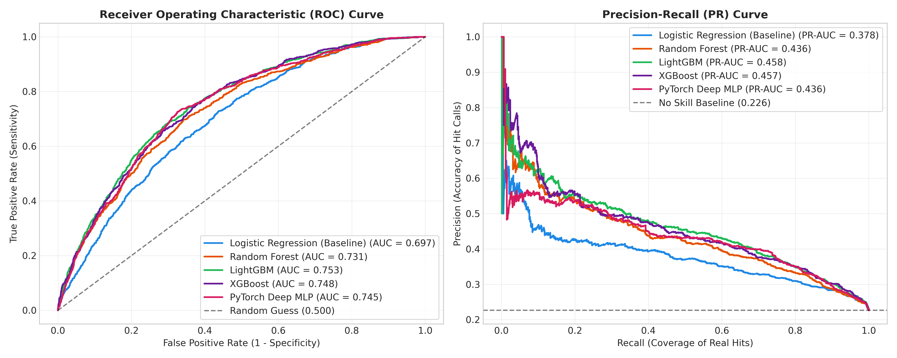
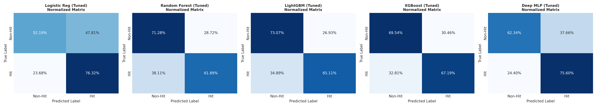
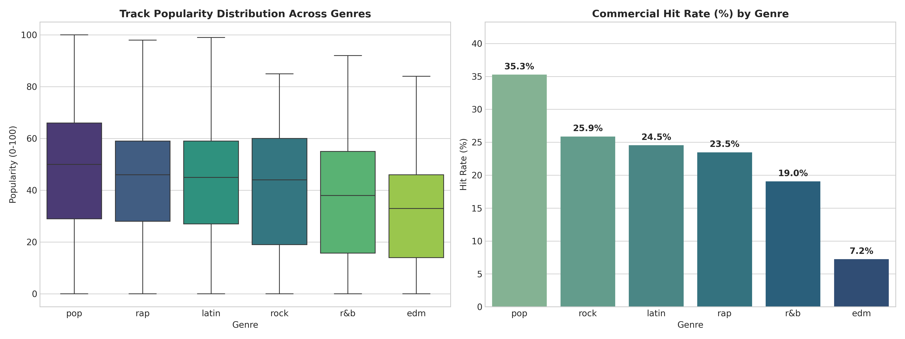
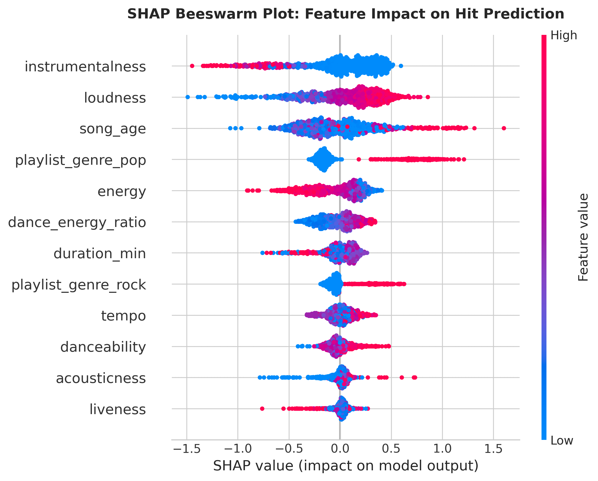

# 🎵 Spotify Hit Predictor
### Predicting commercial hit potential from audio features with ML, deep learning & explainable AI

[](https://www.python.org/)
[](https://pytorch.org/)
[](https://lightgbm.readthedocs.io/)
[](https://shap.readthedocs.io/)
[](app.py)
[](LICENSE)

## Overview
Thousands of tracks are released on streaming platforms every day, and labels and playlist curators have to decide which ones to promote. This project asks:

> **Given only a track's audio profile, genre, and release year, can we predict whether it will reach a Spotify popularity of ≥ 60, and which audio characteristics drive that prediction?**

The pipeline covers:
- **Leakage-safe preprocessing.** The raw data has 32,833 rows; deduplicating by `track_id` leaves 28,352 unique tracks.
- **Domain feature engineering.** Includes mood and party indices, cyclical key encoding, and song age.
- **Five benchmarked models.** Logistic Regression, Random Forest, LightGBM, XGBoost, and a PyTorch MLP.
- **Validation-based threshold tuning.** Needed because the classes are imbalanced (22.6% hits).
- **Model explanations and error analysis.** Uses TreeSHAP, plus a review of real misclassified tracks.
- **Interactive demo.** A Streamlit app.

## Results (held-out test set, N = 4,253)

| Model | Threshold | Accuracy | Precision | Recall | F1 | ROC-AUC | PR-AUC |
|---|---|---|---|---|---|---|---|
| Logistic Regression | 0.46 | 0.577 | 0.318 | **0.763** | 0.449 | 0.697 | 0.378 |
| Random Forest | 0.44 | 0.692 | 0.387 | 0.619 | 0.476 | 0.731 | 0.436 |
| XGBoost | 0.47 | 0.690 | 0.392 | 0.672 | 0.495 | 0.748 | 0.457 |
| PyTorch MLP | 0.50 | 0.653 | 0.370 | 0.756 | 0.497 | 0.745 | 0.436 |
| **LightGBM** | 0.50 | **0.713** | **0.414** | 0.651 | **0.506** | **0.753** | **0.458** |

The no-skill PR-AUC baseline is 0.226. LightGBM scores best on ranking metrics and F1. The deep MLP did not beat gradient boosting, which is common on mid-sized tabular data.




## Key Insights

**EDA**
- Hit rate varies sharply by genre: pop 35.3%, rock 25.9%, latin 24.5%, rap 23.5%, r&b 19.0%, EDM 7.2%.
- Every individual audio feature has only a weak linear correlation with popularity (|r| ≤ 0.12). This motivates the non-linear models.



**What the model learned (SHAP)**



1. **Instrumentalness** is the strongest factor. Tracks without vocals are much less likely to be hits.
2. **Loudness:** louder, modern masters push predictions toward "hit".
3. **Genre:** being in the pop or rock genre raises hit probability.
4. **Energy and duration:** higher energy (at a given loudness) and longer tracks lower it.
5. **Song age** reveals **survivorship bias**: old tracks that still appear in 2020 playlists are already classics, so age pushes predictions upward.

**Error analysis**
- About 40% of false positives have a popularity of 45–59, just under the threshold.
- The most confident false positives are classic-rock remasters (e.g., The Stooges, Blondie). The model over-generalizes "old + rock = hit".
- False negatives are mainly EDM remixes and radio edits. The genre's very low base rate penalizes its exceptions.
- The biggest missing signal is artist fame and marketing reach, which this dataset does not contain.

## Project Structure
```
spotify-hit-predictor/
├── data/                 # raw + processed CSV
├── figures/              # all generated plots
├── models/               # preprocessor, LightGBM, XGBoost, RF, LR, PyTorch weights
├── notebooks/            # end-to-end notebook
├── src/
│   ├── data_loader.py    # download, deduplication, target creation
│   ├── features.py       # feature engineering + ColumnTransformer
│   ├── models.py         # model definitions incl. PyTorch MLP
│   ├── evaluate.py       # metrics, threshold tuning, plots, SHAP
│   ├── train.py          # full pipeline
│   └── build_notebook.py # regenerates the notebook
├── app.py                # Streamlit demo
├── PROJECT_REPORT.md     # course report (Turkish)
└── requirements.txt
```

## Quickstart
```bash
git clone https://github.com/hazalakks/spotify-hit-predictor.git
cd spotify-hit-predictor
pip install -r requirements.txt
python src/train.py        # runs the full pipeline, writes models/ and figures/
streamlit run app.py       # interactive demo
```

## Limitations & Next Steps
- Popularity is a single 2020 snapshot and depends heavily on artist fame. Adding artist-level features is the most promising improvement.
- Possible extensions: model popularity as a regression or ordinal target, tune hyperparameters with Optuna and cross-validation, and add mel-spectrogram CNN or lyrics NLP features.

## Data & References
- Dataset: [TidyTuesday – Spotify Songs (2020-01-21)](https://github.com/rfordatascience/tidytuesday/tree/master/data/2020/2020-01-21), collected via the Spotify Web API.
- Lundberg & Lee (2017), *A Unified Approach to Interpreting Model Predictions*, NeurIPS.
